# Setting up an event

An **event** is one stage of a competition that you generate results for,
such as a group stage, a knockout or a 100 m final. A tournament is usually
one file with an event per stage, for example **Group Stage** then
**Knockout**. Every event goes through the same five steps, shown across
the top of the window:

**1 Sport › 2 Signups › 3 Competition › 4 Groups › 5 Scorinate**

Use **Continue** and **Go Back** in the bottom-right corner to move between
steps. You can't click the step names themselves.

New to xkoranate? Try [Your first event](first-event.md) first. This page
explains every part of each step in more detail.

## Managing events

The events in your file are listed under **EVENTS** in the sidebar.

| To… | Do this |
|---|---|
| Add an event | Click **+** at the bottom of the sidebar, type a name, press <kbd>Enter</kbd> |
| Rename an event | Double-click its name |
| Change the order | Drag an event up or down the list |
| Delete an event | Select it and click **−** |

!!! warning "Deleting doesn't ask first"
    **−** removes the event straight away. If you delete one by mistake,
    close the file *without saving*. The event is still there the next
    time you open the file.

Clicking an event always opens it at step 1. Your settings are all kept,
so click **Continue** to get back to where you were.

---

## Step 1: Sport

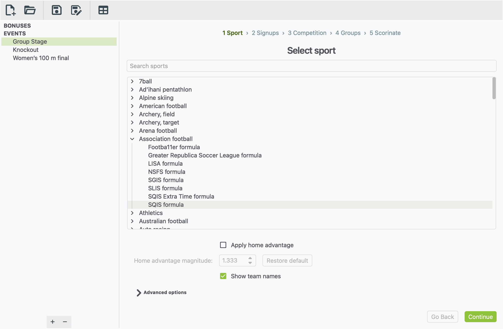

The list is organised by sport. Some sports open up into separate events,
such as the men's 100 m and women's 100 m. Some events also offer
different **formulas**: different rules for deciding results. Association
football, for example, has SQIS, LISA, NSFS and others.

- **Search sports** filters the list as you type. Try a sport (`rugby`), an
  event (`marathon`) or a formula (`SQIS`).
- Click the sport, event or formula you want. **Continue** lights up once
  you've picked one that can actually be played.

**Which formula should I pick?** Each formula has a slightly different way
of generating results, and you can pick whichever one you like. If you're
not sure, SQIS is a good place to start.

### Sport settings

Some sports show settings below the list. They vary by sport, and you can
safely leave all of them at their defaults. The common ones:

| Setting | What it does |
|---|---|
| **Show team names** | Adds the team code after each name in the results, e.g. `Aurelia (AUR)` |
| **Apply home advantage** | Gives the first-named (home) side a small boost. **Restore default** puts the strength back to the usual value. |
| **Home advantage mode** (LISA only) | **Fixed** gives every home side the same boost. The other two let each team have its own home-advantage rating. Hover over each choice to see how it works. |
| **Apply style modifiers** | Adds a **Style** column on the next step, from −5 to +5, so you can make a team more attacking or more defensive |
| **Advanced options** | The formula's inner workings. Only change these if your competition's rules tell you to. |

---

## Step 2: Signups

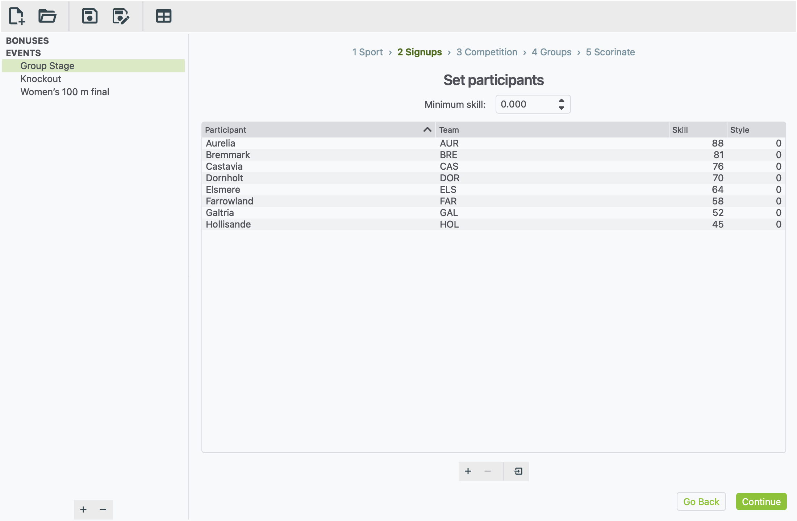

This is the list of everyone taking part. Each row is one team, or one
athlete in an individual sport.

| Column | What to put in it |
|---|---|
| **Participant** | The name that appears in the results, such as `Aurelia` or `Mara Lindqvist` |
| **Team** | The nation's short code, such as `AUR`. Spell it the same way in every event. |
| **Skill** | How strong they are. Higher is better. |

Some sports add more columns, such as **Style** or **Home Adv**. Auto
racing can use **Acceleration**, **Cornering** and **Reliability**
instead of a single skill.

- **Add a row:** click **+**, then double-click each cell to fill it in.
  Press <kbd>Tab</kbd> to move to the next cell.
- **Remove rows:** select them and click **−**. This also takes them out
  of any group or bracket in step 4.
- **Sort the list:** click a column heading.

### Skill range

Many NS Sports events have their own ranking system, and which ranks work
best depends on the formula. Formulas read skill in different ways:

- **Ratio formulas, such as SQIS**, compare the two sides by how many
  times stronger one is than the other. 80 against 40 plays exactly like
  2 against 1. Ranks must be above 0, and only a **Minimum skill** box is
  shown.
- **Range formulas** show **Minimum skill** and **Maximum skill** boxes.
  They judge each team by where it sits between the two, so set them to
  the bottom and top of your ranking system.

**Pin to max participant rank** makes the maximum follow your
strongest entrant automatically. Some formulas don't use a range at all,
and then these boxes are hidden.

### Importing sign-ups from a file

If your sign-ups are in a spreadsheet or a forum post, you don't have to
type them in again.

1. Make a plain text file (`.txt`) with one participant per line.
2. On each line, write the **name**, **team code** and **skill**,
   separated by semicolons:

    ```text
    Aurelia;AUR;88
    Bremmark;BRE;81
    Castavia;CAS;76.5
    ```

3. Click the **Import from text file** button. It's the right-hand button
   under the list.
4. Choose your file.

The new rows are added below any already in the list.

!!! tip "Getting the file right"
    - **Don't add a heading line.** A line like `Name;Team;Skill` would
      be imported as a team called "Name".
    - **Lines with fewer than three parts are skipped**, with no warning.
      If someone is missing after an import, check their line.
    - **Decimal commas are fine.** `76,5` is read as 76.5.
    - **Sports with extra columns** read them in order after the skill.
      For example, `Aurelia;AUR;88;2` sets a Style of 2.
    - **From a spreadsheet:** save it as CSV, then replace the commas with
      semicolons in a text editor. Or build each line with a formula, such
      as `=A2&";"&B2&";"&C2`.
    - **Save the file as UTF-8** (most editors do this by default) so that
      accented names come through correctly.

---

## Step 3: Competition

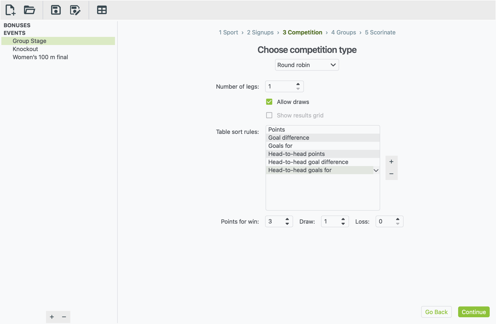

Pick how the event is played. Only the formats that suit your sport are
offered.

| Format | What it means | Good for |
|---|---|---|
| **Round robin** | Everyone in a group plays everyone else in that group | League tables, group stages |
| **Inter-conference round robin** | A league split into conferences: teams play their own conference and the other conferences too | Leagues with conferences or divisions |
| **Single elimination** | A knockout cup: lose and you're out | Cups, play-offs |
| **Individual matches** | One-off matches: 1st v 2nd, 3rd v 4th, and so on, in each group | Friendlies, finals, set fixtures |
| **Mass start** | Everyone competes at once and is ranked | Races, field events |
| **Multiple-run competition** | Several runs or attempts, added together | Skiing, bobsleigh, diving |
| **Shooting competition** | A qualifying round, then a final | Shooting |
| **Archery ranking round** | A ranking round for archery | Archery |

Most formats have settings below the drop-down:

- **Round robin**
    - **Number of legs:** 2 means home and away.
    - **Allow draws.**
    - **Points for win / draw / loss.**
    - **Table sort rules:** what decides places when points are level.
      Drag to reorder, **+** to add a rule, **−** to remove one.
    - **Show results grid:** a grid of every result. Only available with
      2 legs.
- **Inter-conference round robin** has the same settings, apart from the
  results grid, plus:
    - **Legs in conference:** how many times teams in the same conference
      meet. 2 means home and away.
    - **Legs v others:** how many times each team meets every team in
      each other conference. 0 keeps the conferences apart.
    - **Overall table:** adds one table of every team after the
      conference tables.
    - **Win v others:** points for a win, draw or loss against another
      conference. It matches the in-conference points until you change it.

    See [Conferences](#conferences) for how to set up the groups.
- **Single elimination:** **Third-place playoff** adds a match between
  the two beaten semi-finalists.
- **Mass start:** **Sort results** lists finishers in order. **Show
  overall ranking across all groups** adds one combined ranking, which is
  handy for heats.
- **Multiple-run competition:** set how many **Runs** there are.
- **Shooting** and **Archery:** set how many go through to the next
  round. A note below explains how ties are settled.

---

## Step 4: Groups

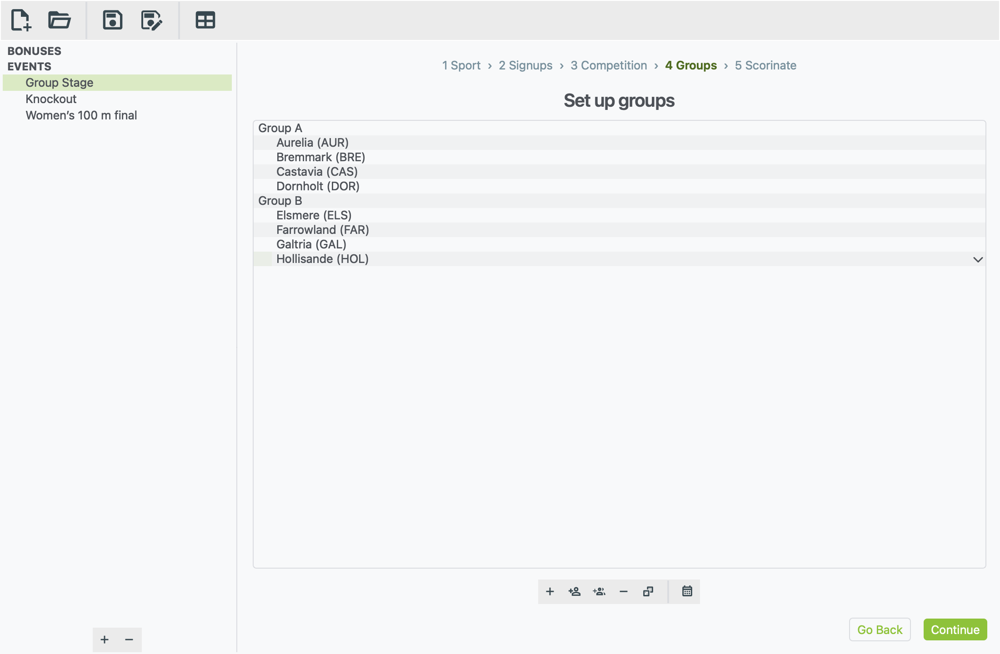

Here you decide who is in which group. A group stage has several, such as
Group A and Group B. Everyone in a group plays everyone else
in that group, and each group gets its own table. A race puts everyone
running in it into one group, for example "Final" or "Heat 1".

The buttons under the list, from left to right:

| Button | What it does |
|---|---|
| **+** Create a group | Adds a new group. Type its name and press <kbd>Enter</kbd>. |
| Person with **+** | **Add a participant** to the selected group, picked from a list |
| Two people with **+** | **Add all available participants** to the selected group |
| **−** | Removes the selected groups or participants |
| Dice | **Randomize this group**: shuffles its order |
| Calendar | **View full schedule**: the full list of fixtures |

You can drag participants from one group to another. To swap who is in a
place, double-click their name and choose someone else.

!!! info "Order matters for one-off matches"
    For **Individual matches**, the 1st and 2nd names in a group play each
    other, then the 3rd and 4th, and so on. The first name in each pair is
    the home side.

### Conferences

For an **Inter-conference round robin**, each group is one conference, and
this step is called **Conferences**. Name the groups after your
conferences, for example "Pacific" and "Atlantic". Those names head the
fixtures and the tables.

- Conferences can be different sizes. A team in a smaller conference sits
  out the odd matchday.
- Matchdays against other conferences are spread evenly through the
  season. The same teams always give the same schedule.
- Each conference's table counts all of its teams' games, including the
  ones against other conferences.

Click **View full schedule** to check the fixtures before you scorinate.

### Knockout brackets

If you chose **Single elimination**, this step is called **Bracket**
instead. You arrange the first-round draw, and xkoranate works out every
later round from the winners.

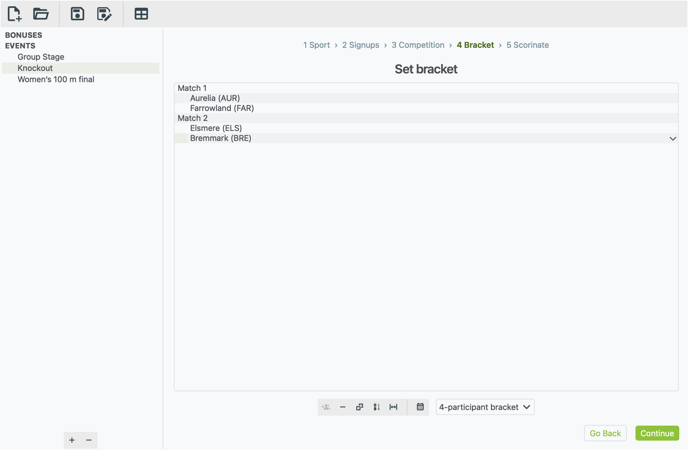

1. **Pick the size.** The drop-down on the right sets the bracket size:
   4, 8, 16 and so on.
    - If you have fewer teams than places, the empty places become
      **byes**. A bye means the team opposite goes through without
      playing.
    - If you pick a smaller size than your number of teams, the teams
      that don't fit are left out. Pick the bigger size again to bring
      them back.
2. **Make the draw.** Click one of these buttons:
    - **Dice:** draw the bracket completely at random.
    - **Seed the draw by skill:** the strongest plays the weakest, and
      the top two seeds can only meet in the final.
    - **Keep the top seeds apart:** choose how many seeds. They are spread
      across the bracket, and everyone else is drawn at random around
      them.
3. **Adjust by hand if you like.** Drag teams between matches, or
   double-click a place and pick a team, or pick **— BYE —** to leave it
   empty. The **−** button turns the selected place into a bye.

Click the calendar button to see the whole knockout. Later rounds read
"Match 1 winner v Match 2 winner" until they've been played:

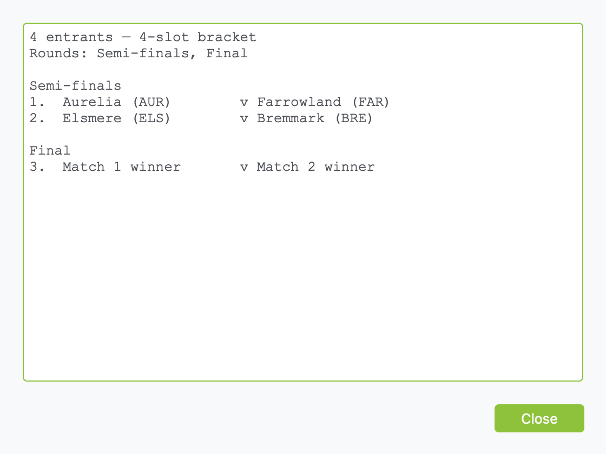

!!! warning "Changing the draw after playing"
    If you change the bracket after generating results, those results no
    longer fit the draw, so they are deleted. xkoranate asks before it
    does this.

---

## Step 5: Scorinate

This is where results are made.

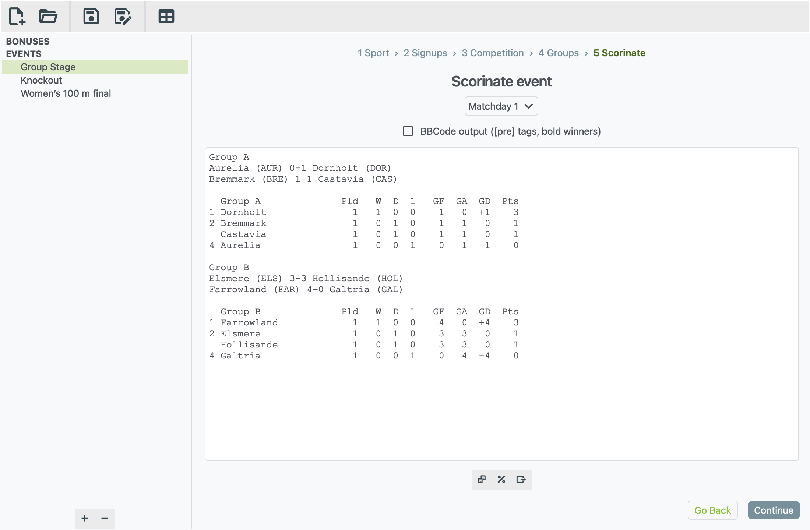

The three buttons under the results, from left to right:

| Button | What it does |
|---|---|
| Dice: **Scorinate event** | Generates results for the round shown in the drop-down |
| %: **View match odds** | Shows each side's chance of winning. Only for sports with head-to-head matches. |
| Arrow: **Export to file** | Saves the results shown as a text file |

### Rounds

When an event has more than one round, a drop-down appears above the
results. Rounds are called "Matchday 1", "Quarter-finals", "Run 2" and so
on, depending on the format.

- Pick a round to see its results.
- Pick a round that hasn't been played yet and click the dice to play it.
- If you skip ahead, xkoranate offers to play the rounds in between first.

In a knockout cup, each round ends with the next round's fixtures:

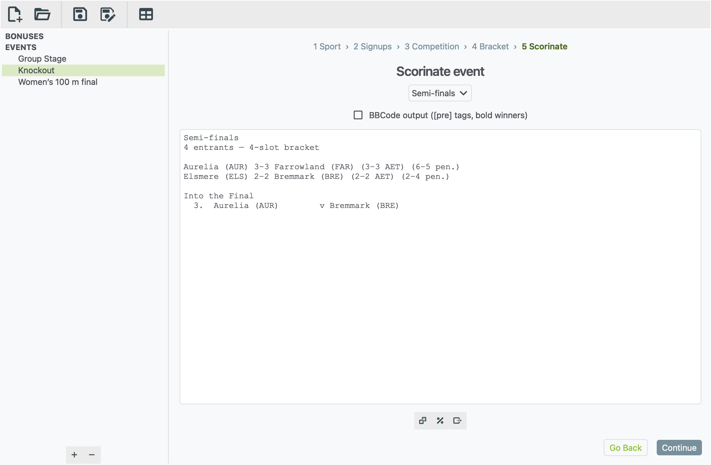

A race shows everyone in finishing order. [Your first race](first-race.md)
walks through setting one up.

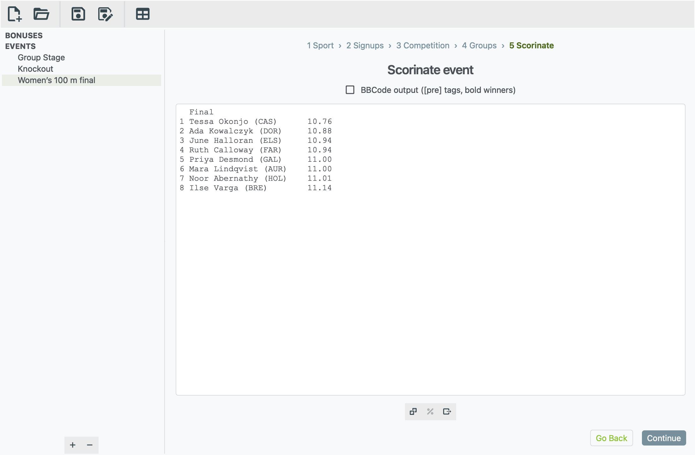

### Playing a round again

Clicking the dice on a round that already has results throws those
results away and makes new ones. xkoranate always asks first. If you redo
an earlier round, every round after it is cleared too, because those
results depended on it.

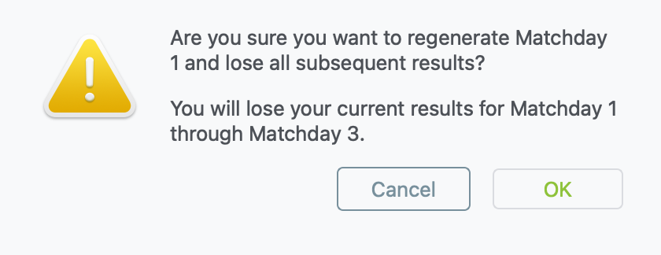

### Match odds

Click **View match odds** to see how likely each result is before you
play a round. xkoranate plays each fixture 1,000 times to work these out.
This is handy for previews and for checking that your skill numbers make
sense.

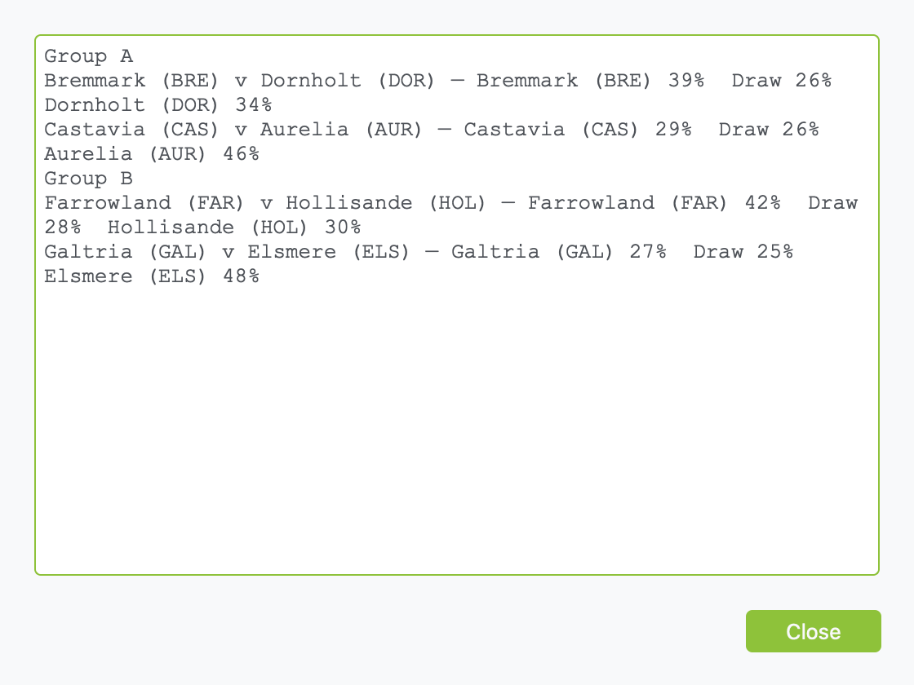

### Qualification markers

Round-robin, inter-conference and mass-start events have a **Format
qualifications** box.
Tick it to mark a **Q** next to everyone who has qualified and an **E**
next to everyone who has been knocked out. In a league table the marker
goes in a column after the points. In heats it goes after each result.

Choose how many places go through:

- **Top X:** the top X of a single table.
- **Top X in each group:** when there are several groups or heats.
- **+ best N:** also takes the best N who finish one place below the cut,
  for example the four best third-placed teams, compared across groups.

A marker only appears once no remaining result can change it. Only the
table's first sort rule (usually points) can be worked out ahead of time,
so a team that could still finish level on it isn't marked until its group
is complete. A tie that sits across the cut stays unmarked.

The markers are added to what you see and export, not to the saved
results, so you can change the setting at any time without scorinating
again. The setting is saved with the event.

In an inter-conference event, each conference counts as a group, and its
games against other conferences count towards it, at their own points if
you set any. The overall table shows each team's mark from its conference.

### Posting your results

Tick **BBCode output** before you copy. The results are wrapped in
`[pre]…[/pre]` so the columns line up on the forum, and each match winner
is shown in **bold**.

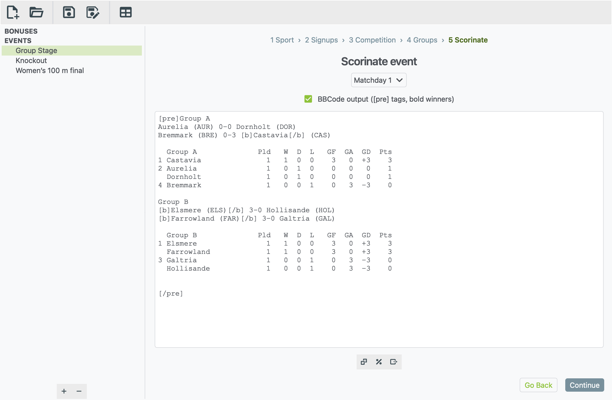

To copy them:

1. Click in the results.
2. Press <kbd>Ctrl</kbd> <kbd>A</kbd>, then <kbd>Ctrl</kbd> <kbd>C</kbd>.
   On a Mac, use <kbd>⌘</kbd> instead of <kbd>Ctrl</kbd>.
3. Paste into your post.

**Export to file** saves exactly what's on screen to a `.txt` file. That
means the round you're looking at, with BBCode included if the box is
ticked.

!!! tip "Building a league table from several rounds"
    Export each matchday to its own file, then import them one after
    another into the [table generator](table-generator.md).

Results are stored in the event, so remember to **save** the file.
