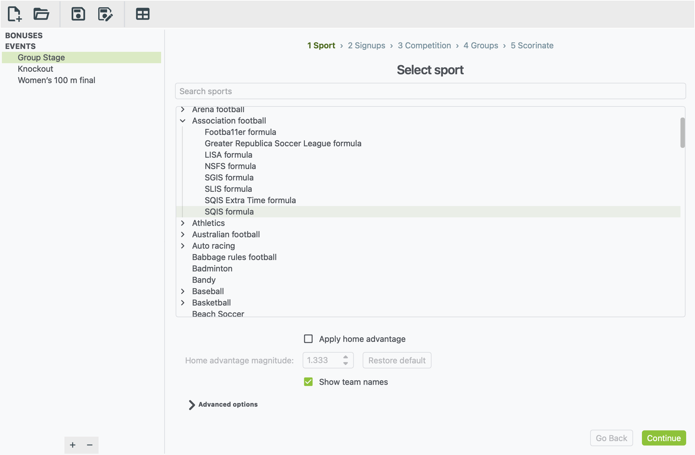
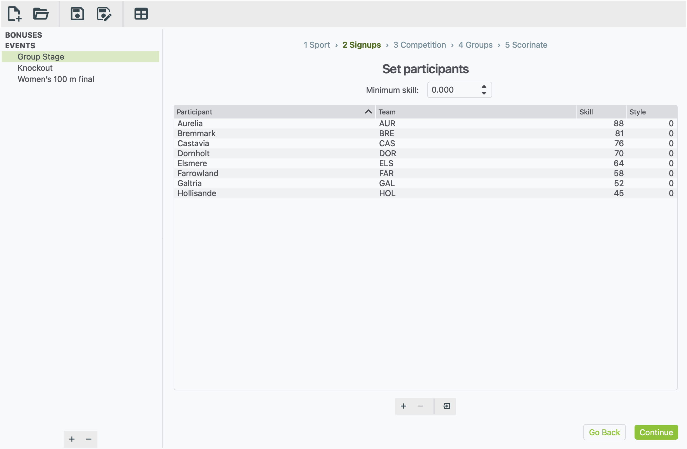
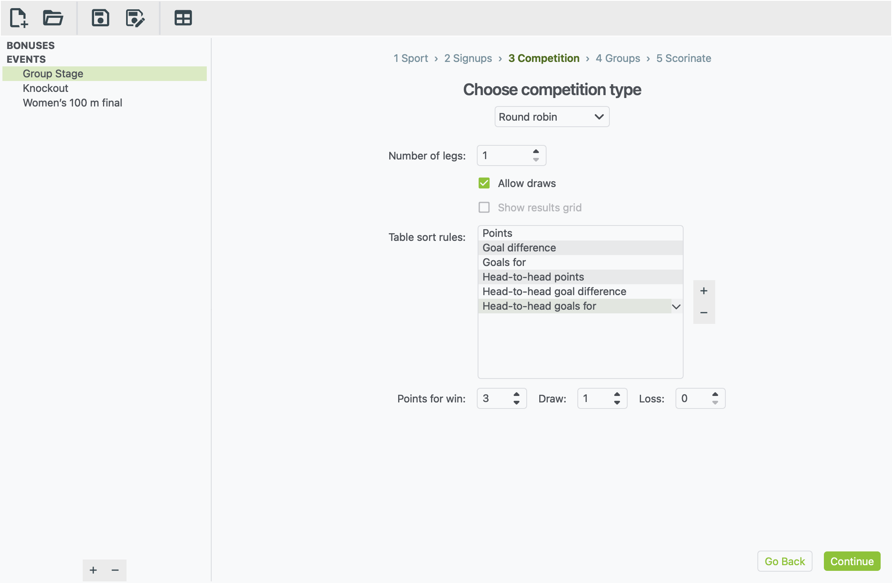
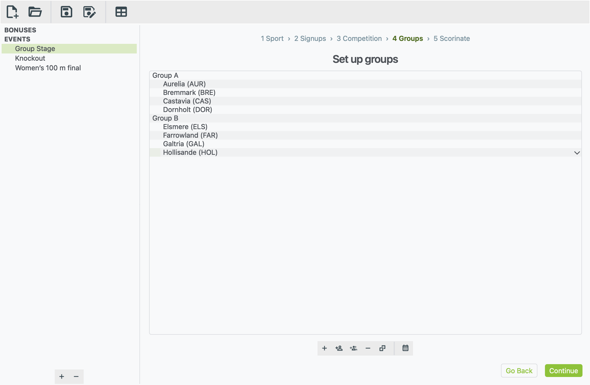
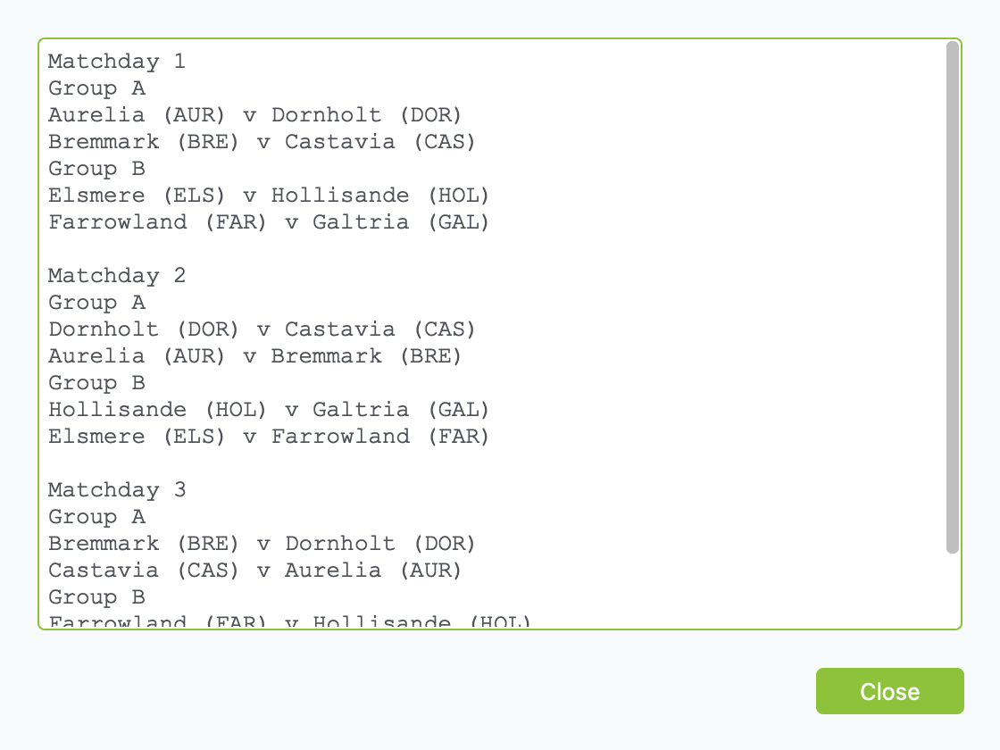
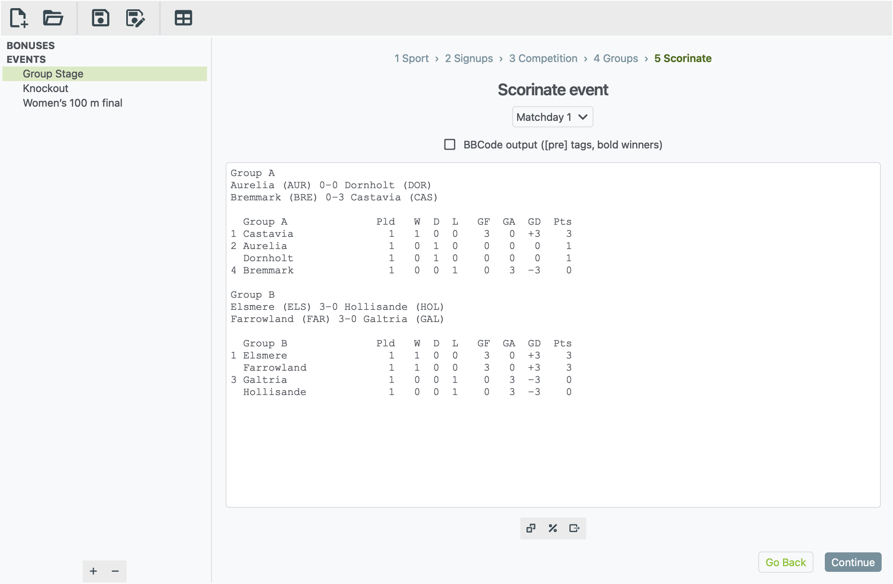
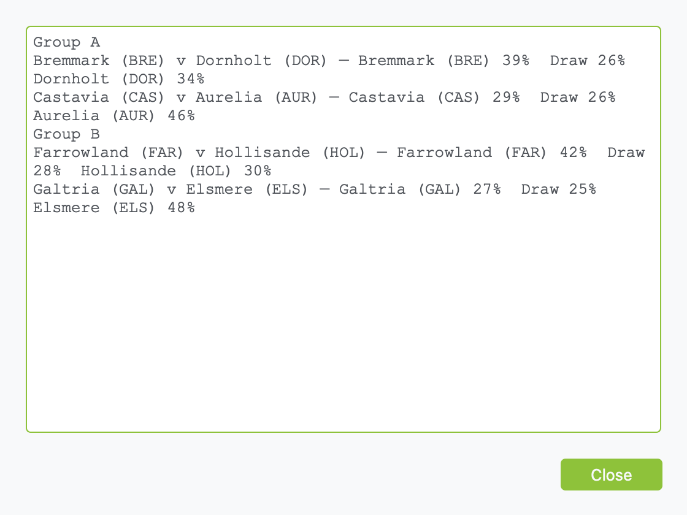

# Your first event

This walk-through takes about 10 minutes. You'll set up the group stage of
a football tournament: eight nations in two groups of four, where everyone
plays everyone else in their group. At the end you'll have a matchday of
scores and both group tables, ready to post.

You'll go through the five steps xkoranate uses for every event. The bar
across the top of the window always shows which step you're on:

**1 Sport › 2 Signups › 3 Competition › 4 Groups › 5 Scorinate**

Use **Continue** and **Go Back** in the bottom-right corner to move
between steps.

## Create the event

A tournament is usually one file with an event for each stage, such as
**Group Stage** and **Knockout**. You'll make the Group Stage here.

1. Open xkoranate.
2. Click **+** at the bottom of the sidebar. A new, empty event appears
   under **EVENTS** with its name ready to type.
3. Type `Group Stage` and press <kbd>Enter</kbd>.

You can rename an event later by double-clicking its name.

## Step 1: pick the sport

1. Click in **Search sports** and type `football`.
2. Under **Association football**, click **SQIS formula**.

Many sports offer more than one **formula**. Each formula has a slightly
different way of generating results, and you can pick whichever one you
like. This example uses SQIS.

Some sports show extra settings below the list once you pick them, such as
**Apply home advantage** here. You can leave these alone. They are
explained in [Setting up an event](building-an-event.md#step-1-sport).

Click **Continue**.

## Step 2: add the teams

Each row is one team, or one athlete in individual sports. Add eight rows:

1. Click **+** under the list. A new row appears.
2. Double-click each cell to fill it in:
    - **Participant**: the name shown in results, such as `Aurelia`.
    - **Team**: a short code for the nation, such as `AUR`.
    - **Skill**: how strong they are, such as `88`. Higher is better.
3. Repeat for the other seven nations.

!!! tip "Got a sign-up list already?"
    You can import a whole list from a text file instead of typing it in.
    See [Importing sign-ups from a file](building-an-event.md#importing-sign-ups-from-a-file).

**What skill numbers should I use?** Many NS Sports events have their own
ranking system, and which ranks work best depends on the formula.

SQIS compares ranks as a **ratio**. It looks at how many times stronger one
team is than the other, not at the gap between them:

- 80 against 40 plays exactly like 2 against 1. In both cases one team is
  twice as strong.
- 90 against 80 is a close match, because the ratio is close to 1.
- Every rank must be **above 0**.

The **Minimum skill** box above the list sets the lowest rank you can
type. You can leave it at 0.

Click **Continue**.

## Step 3: choose the format

1. Open the drop-down and choose **Round robin**. This means everyone
   plays everyone.
2. Leave the settings as they are:
    - one **leg** (each pair plays once; choose 2 for home and away)
    - draws allowed
    - 3 points for a win, 1 for a draw

**Table sort rules** decide the order when teams finish level on points.
They are applied from the top down: points first, then goal difference,
then goals scored, then head-to-head. You can change them:

- **Add a rule:** click **+** next to the list, then pick a rule from the
  drop-down. Choices include away goals, wins and a coin flip.
- **Remove a rule:** select it and click **−**.
- **Change a rule:** double-click it and pick another.
- **Reorder the rules:** drag a rule up or down the list.

Click **Continue**.

## Step 4: split the teams into groups

1. Click **+** in the toolbar under the list. A new group appears, ready
   to name.
2. Type `Group A` and press <kbd>Enter</kbd>.
3. Click **+** again, type `Group B` and press <kbd>Enter</kbd>.
4. Fill Group A. Select it, then click the **Add a participant** button
   (a person with a plus sign) and pick a team from the list. Do this
   four times.
5. Fill Group B the same way with the other four teams.

You can also click **Add all available participants** (two people with a
plus sign) to put everyone in one group, then drag four of them into the
other group.

To check the fixtures, click the calendar button (**View full
schedule**):

Click **Close**, then click **Continue**.

## Step 5: scorinate

1. Click the **dice** button under the empty box. This is
   **Scorinate event**.
2. The scores for **Matchday 1** appear, with a table for each group.

**Want to know the odds?** Before you roll the dice, click the **%**
button (**View match odds**) under the results box. It shows every fixture
in the selected matchday, with each side's chance of winning and the
chance of a draw. xkoranate works these out by playing each match 1,000
times.

To play the next matchday:

1. Pick **Matchday 2** from the drop-down above the results.
2. Click the dice again.

You can also pick **Matchday 3** and click the dice once. xkoranate asks
whether to fill in Matchday 2 on the way.

!!! warning "Rolling the dice again replaces results"
    Clicking the dice on a matchday that already has results makes new
    ones. xkoranate asks before it does this, so you won't lose a matchday
    by accident.

## Post it

1. Tick **BBCode output** above the results. This wraps the results in
   `[pre]` tags so the columns line up on the forum, and makes each
   winner **bold**.
2. Click in the results box.
3. Press <kbd>Ctrl</kbd> <kbd>A</kbd> to select all, then <kbd>Ctrl</kbd>
   <kbd>C</kbd> to copy. On a Mac, use <kbd>⌘</kbd> instead of
   <kbd>Ctrl</kbd>.
4. Paste into your forum post.

To keep a copy as a file instead, click **Export to file**. It's the
right-hand button under the results.

## Save

Choose **File › Save**, give the file a name, and you're done. Next time,
use **File › Open** to come back to it. Your results are kept in the file.

## Where next?

- [Your first race](first-race.md) sets up a 100 m final, which works a
  little differently from matches.
- When the groups are finished, make a **Knockout** event in the same
  file for the teams that went through. See
  [Knockout brackets](building-an-event.md#knockout-brackets).
- [Setting up an event](building-an-event.md) explains everything on each
  step, including knockout cups and races.
- The [table generator](table-generator.md) makes a league table from
  results you already have.
