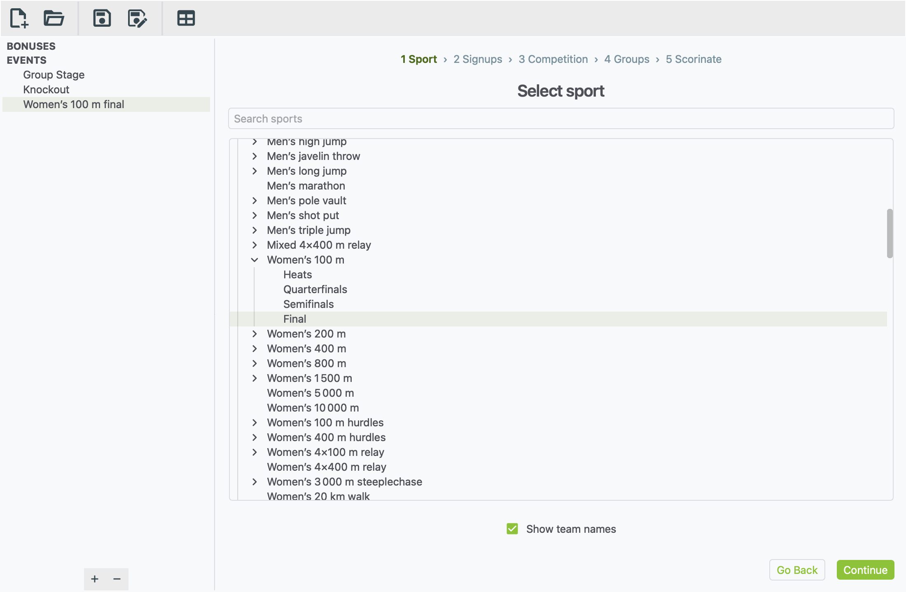
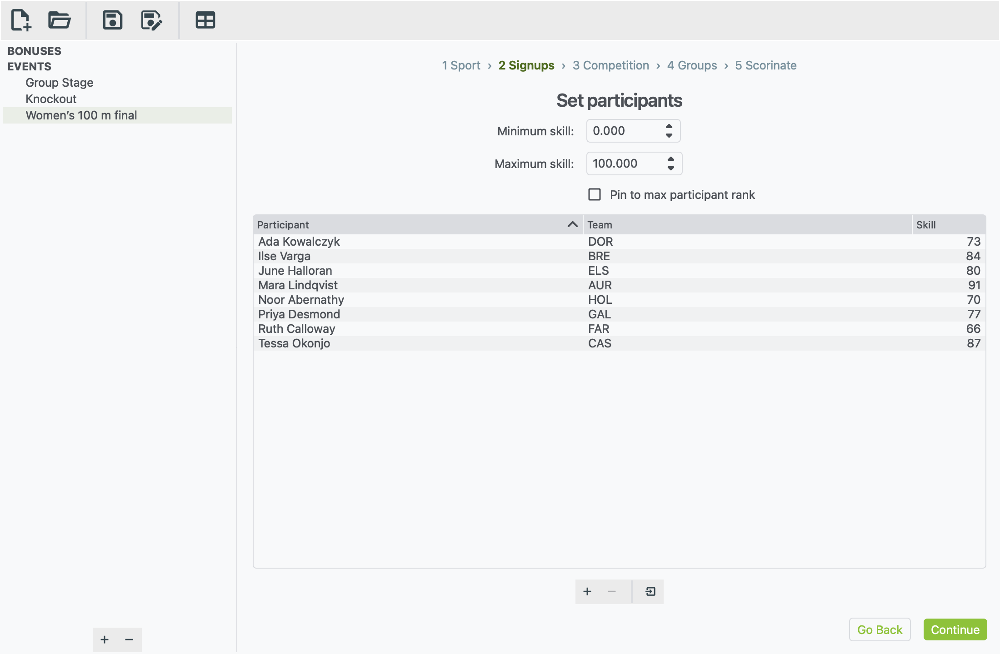
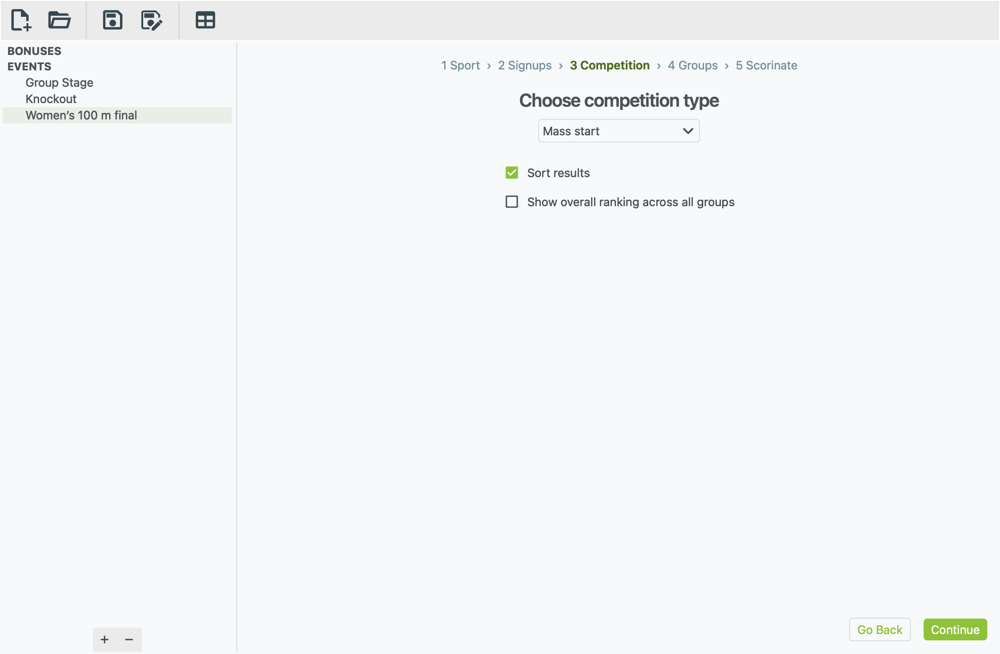
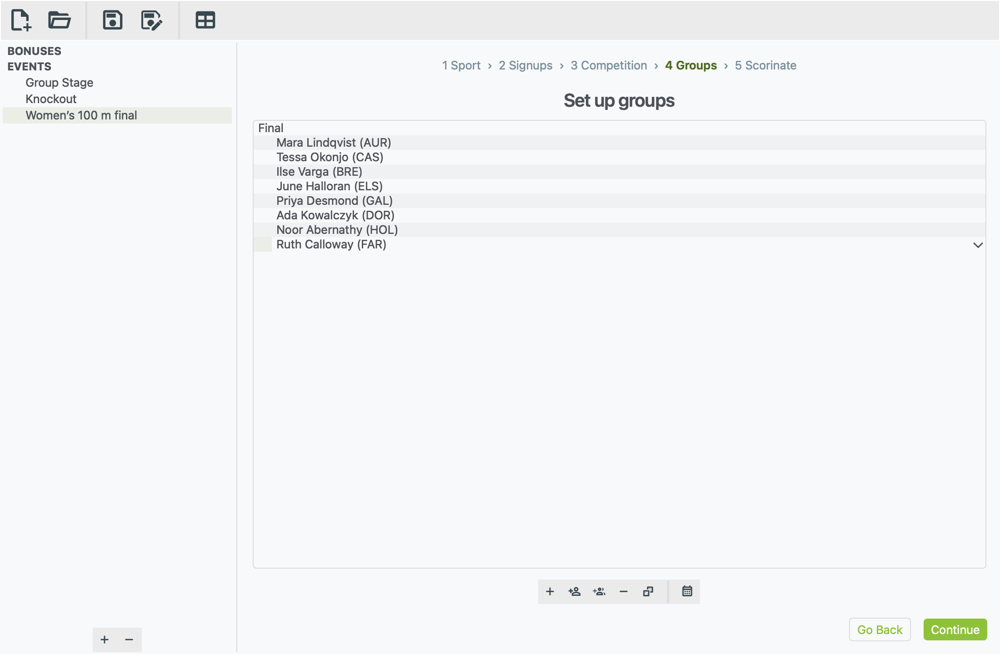
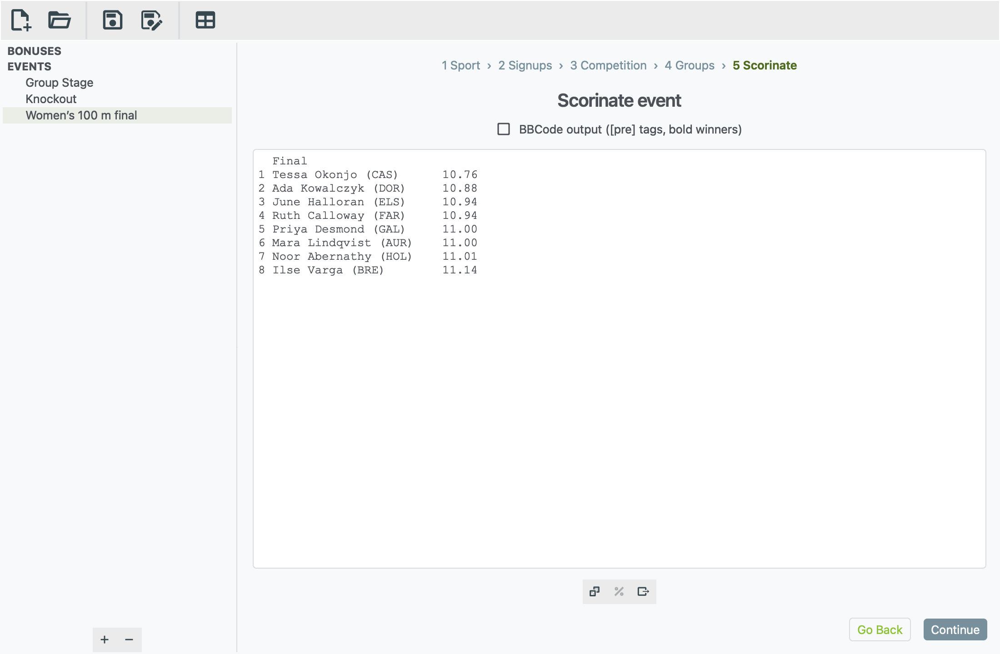

# Your first race

This walk-through takes about 5 minutes. You'll set up a women's 100 m
final with eight athletes, run it, and get a results list in finishing
order.

Races work a little differently from matches. Everyone competes at once,
there are no fixtures, and there's one round instead of several matchdays.
The five steps are the same, though:

**1 Sport › 2 Signups › 3 Competition › 4 Groups › 5 Scorinate**

If you haven't used xkoranate before, [Your first event](first-event.md)
explains the basics in more detail.

## Create the event

1. Click **+** at the bottom of the sidebar.
2. Type `Women's 100 m final` and press <kbd>Enter</kbd>.

Each round of a race is its own event. A full 100 m competition might have
three events: heats, semi-finals and a final.

## Step 1: pick the race

1. In the list, click the arrow next to **Athletics**.
2. Click the arrow next to **Women's 100 m**.
3. Click **Final**.

You can also type `100 m` in **Search sports** to find it faster.

Many races are split into rounds: **Heats**, **Quarterfinals**,
**Semifinals** and **Final**. Pick the round you're running. Each round
has its own range of times:

- The **Final** is a tight field, running from about 10.8 to 11.2
  seconds.
- The **Heats** spread much wider, from about 11.1 to 14.8 seconds.

Leave **Show team names** ticked. It puts each athlete's team code after
their name in the results.

Click **Continue**.

## Step 2: add the athletes

Add one row per athlete:

1. Click **+** under the list.
2. Double-click each cell to fill it in:
    - **Participant**: the athlete's name, such as `Mara Lindqvist`.
    - **Team**: their nation's code, such as `AUR`.
    - **Skill**: how good they are, such as `91`.
3. Repeat for the other seven athletes.

To bring in a list you already have, see
[Importing sign-ups from a file](building-an-event.md#importing-sign-ups-from-a-file).

**Minimum skill and Maximum skill.** Unlike SQIS football, this race
formula uses a **range**. Each athlete is judged by where their skill sits
between the minimum and the maximum, so set these two boxes to the bottom
and top of your ranking system. Here that's 0 and 100.

- An athlete at the maximum tends to run near the fast end of the round's
  times. In this final, that's about 10.8 seconds.
- An athlete near the minimum tends to run near the slow end, about 11.2.

There's always some luck, so the fastest athlete on paper doesn't always
win.

**Pin to max participant rank** sets the maximum to your fastest
athlete's skill automatically, so the best athlete in the field is
treated as top level. Leave it unticked if your ranking system has a fixed
top.

Click **Continue**.

## Step 3: choose the format

**Mass start** is already chosen. It means everyone races at once and is
ranked by their time.

- **Sort results** lists the athletes in finishing order. Leave it ticked.
- **Show overall ranking across all groups** adds one combined list across
  every group. You only need this for heats, to see who was fastest
  overall. See [Running heats](#running-heats) below.

Click **Continue**.

## Step 4: put everyone in the race

For a race, a **group** is one race: one heat, or one final.

1. Click **+** in the toolbar under the list.
2. Type `Final` and press <kbd>Enter</kbd>.
3. With the group selected, click **Add all available participants** (the
   two people with a plus sign).

The order of athletes in the group doesn't matter for a race.

Click **Continue**.

## Step 5: run the race

1. Click the **dice** button under the empty box (**Scorinate event**).
2. The result appears: every athlete in finishing order, with their time.

Some things work differently for a race:

- **There's no round drop-down.** The whole race is one round.
- **Match odds aren't available.** The **%** button is greyed out because
  there are no head-to-head matches.
- **Sometimes an athlete doesn't finish.** Like a real race, there's a
  small chance an athlete is disqualified or doesn't finish. They're shown
  as **DQ** or **DNF** instead of a time.

To post it, tick **BBCode output**, click in the results, then select all
and copy (<kbd>Ctrl</kbd> <kbd>A</kbd>, <kbd>Ctrl</kbd> <kbd>C</kbd>, or
<kbd>⌘</kbd> on a Mac). Or click **Export to file** to save it as a text
file. Then **save** your xkoranate file.

## Running heats

To run heats before a final:

1. Make an event called `Women's 100 m heats` and pick **Heats** in step 1.
2. In step 3, tick **Show overall ranking across all groups**.
3. In step 4, make one group per heat (`Heat 1`, `Heat 2`, …) and put the
   athletes in them. To split the field evenly, add everyone to one heat
   and drag some into the others.
4. Scorinate. You get each heat's result, then one list of everyone
   ranked by time.
5. Make the final as above, with the athletes who qualified.
