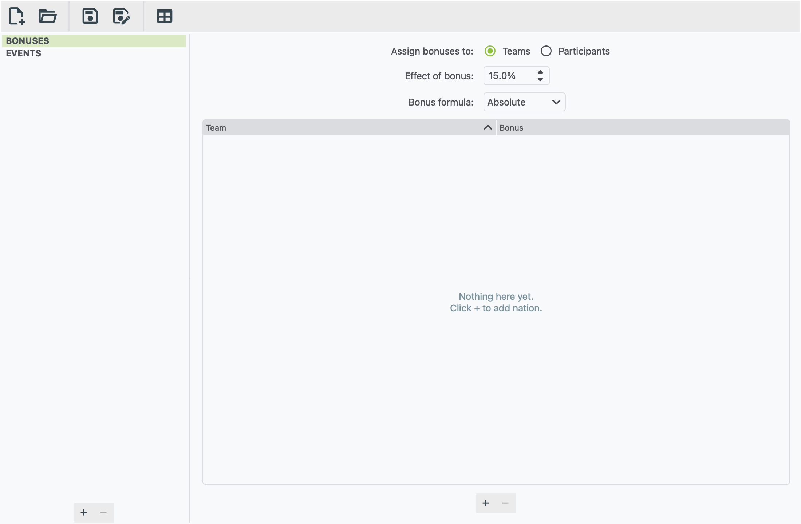
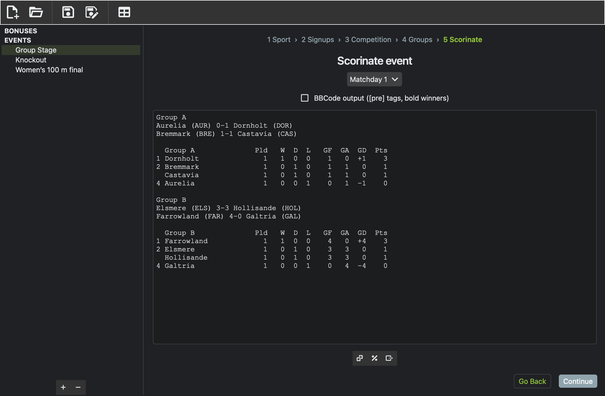
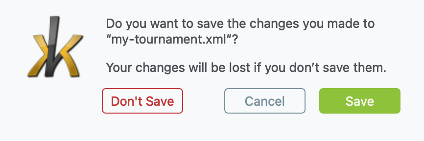

# Installing xkoranate

xkoranate is free and runs on Windows, Mac and Linux. There is no installer:
you download a zip, unpack it, and open the app inside.

## 1. Download

Go to the
[Releases page](https://github.com/NS-Sports/xkoranate-ce-python/releases)
and, under the newest release, open **Assets**. Pick the file for your
computer:

| Your computer | Download the file ending in |
|---|---|
| Windows | `-windows.zip` |
| Mac with an Apple chip (M1, M2, M3, M4…) | `-macos-arm64.zip` |
| Older Mac with an Intel chip | `-macos-x86_64.zip` |
| Linux | `-linux.tar.gz` |

!!! tip "Which Mac do I have?"
    Open the Apple menu (top-left corner of the screen) and choose **About This Mac**. If it lists a
    **Chip** (such as "Apple M2"), use `arm64`. If it lists a
    **Processor** (such as "Intel Core i5"), use `x86_64`.

## 2. Unpack it

Double-click the downloaded file to unpack it, then move what's inside
somewhere you'll find it again. Your Applications folder or your Documents
folder are both fine.

- **Windows:** you get an `xkoranate` folder. The app is
  `xkoranate.exe` inside it. Keep the whole folder together, because the
  app needs the files next to it.
- **Mac:** you get `xkoranate.app`.
- **Linux:** you get an `xkoranate` folder. The app is the file called
  `xkoranate` inside it.

## 3. Open it the first time

xkoranate is made by volunteers and isn't registered with Apple or
Microsoft. Your computer will warn you the first time you open it. This
warning is expected, and you only have to deal with it once.

=== "Windows"

    1. Double-click `xkoranate.exe`.
    2. If a blue "Windows protected your PC" box appears, click
       **More info**.
    3. Click **Run anyway**.

=== "Mac"

    1. Right-click (or Control-click) `xkoranate.app` and choose **Open**.
    2. Click **Open** in the box that appears.

    If your Mac only offers **Done** or **Move to Bin**:

    1. Click **Done**.
    2. Open **System Settings › Privacy & Security**.
    3. Scroll down and click **Open Anyway** next to the message about
       xkoranate.

=== "Linux"

    Double-click the `xkoranate` file inside the folder.

    It needs a reasonably recent system: Ubuntu 22.04, Linux Mint 21,
    Debian 12, Fedora 36 or newer. Nothing else needs installing. If
    nothing happens, see [Troubleshooting](troubleshooting.md).

## A quick look around

**Toolbar (top).** From left to right:

- **New file** and **Open file**
- **Save** and **Save as**
- **Table generator**, which turns match results into a league table

Hover over any button to see what it does.

**Sidebar (left).** It has two headings:

- **BONUSES** holds roleplay bonuses for this file. You can ignore it for now.
- **EVENTS** lists your events. Add one with the **+** button at the
  bottom of the sidebar.

**Main area (right).** This shows whatever you've selected in the sidebar.

!!! info "One file, many events"
    One saved xkoranate file can hold every event of a tournament: the
    group stage, the knockout rounds, the 100 m and the marathon. You
    don't need a separate file for each event.

### Menus

| Menu | What's in it |
|---|---|
| **File** | New, Open, Save, Save as, Table generator, Quit |
| **View** | The colour theme: **Light**, **Dark** or **True Dark (OLED)**. xkoranate remembers your choice. |
| **Help** | **xkoranate manual** opens this guide. The shortcut is <kbd>F1</kbd>, or <kbd>⌘</kbd> <kbd>?</kbd> on a Mac. |

### Saving your work

xkoranate doesn't save on its own. Save with **File › Save** (or
<kbd>Ctrl</kbd> <kbd>S</kbd>, or <kbd>⌘</kbd> <kbd>S</kbd> on a Mac).

If you try to close the window or open another file with unsaved changes,
xkoranate asks you first:

- **Save** keeps your changes.
- **Discard** throws them away.
- **Cancel** takes you back to what you were doing.

Files are saved as `.xml`. They also work in the original xkoranate
program, and the original's files work here.

## Next

[Run your first event →](first-event.md)
