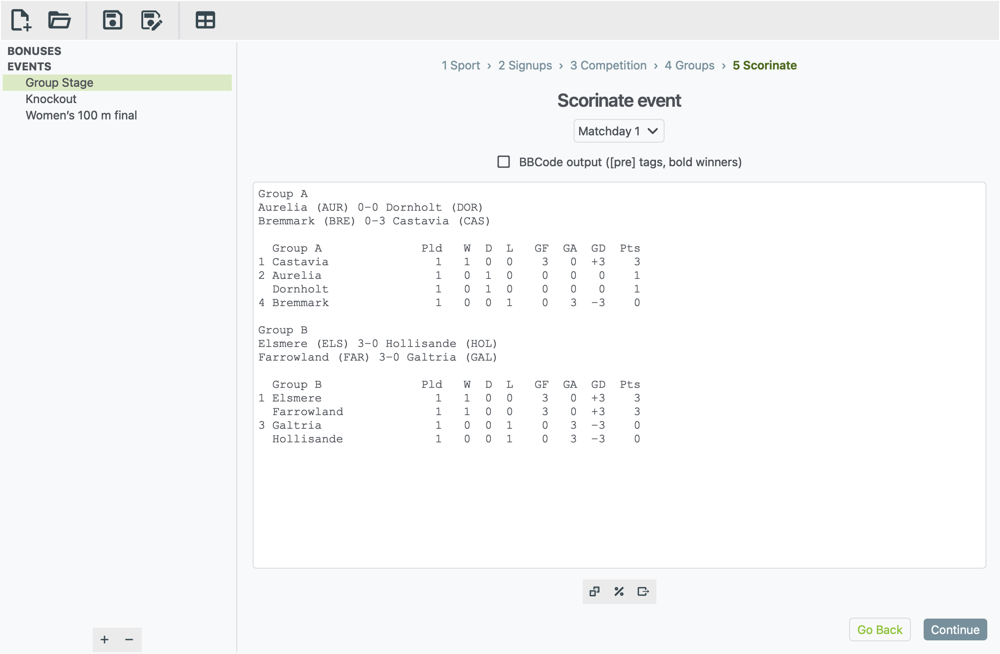

# xkoranate user guide

xkoranate makes up sports results for roleplay. You tell it who is
competing, how good each of them is, and what kind of competition it is.
It then plays the matches or races for you and gives you results you can
paste straight into a forum post.

It is the results tool used by **NS Sports**, the sports roleplay community
on [NationStates](https://www.nationstates.net/). xkoranate calls making
results **scorinating**, and you'll see that word throughout the app.

## Start here

1. **[Install xkoranate](getting-started.md).** Download it, open it, and
   get past your computer's "unknown app" warning. About 5 minutes.
2. **[Run your first event](first-event.md).** A guided walk-through: a
   football group stage with two groups of four, from an empty window to
   results ready to post. About 10 minutes.
3. **[Run your first race](first-race.md).** A women's 100 m final, start
   to finish. About 5 minutes.
4. **Keep this guide handy.** Press <kbd>F1</kbd> in xkoranate at any time
   to open it, or choose **Help › xkoranate manual**.

## What can it do?

- **Over a hundred events in more than sixty sports.** These include
  football, rugby, basketball, cricket, tennis, athletics, swimming,
  skiing, cycling, gymnastics, shooting and archery.
- **Every common competition format.** You can run:
    - a league where everyone plays everyone
    - a knockout cup
    - one-off matches
    - a race where everyone starts together
    - events with several runs or attempts
- **League tables** from any set of match results, including results that
  didn't come from xkoranate.

## Find what you need

| I want to… | Go to |
|---|---|
| Understand each screen of an event | [Setting up an event](building-an-event.md) |
| Load a sign-up list from a file | [Importing sign-ups](building-an-event.md#importing-sign-ups-from-a-file) |
| Run a knockout cup | [Knockout brackets](building-an-event.md#knockout-brackets) |
| Post results on the forum | [Posting your results](building-an-event.md#posting-your-results) |
| Build a league table | [Table generator](table-generator.md) |
| Fix a problem | [Troubleshooting](troubleshooting.md) |
| Look up a word | [Glossary](glossary.md) |

## Getting help

- **Something not working?** First check
  [Troubleshooting](troubleshooting.md). If that doesn't help,
  [report a bug](https://github.com/NS-Sports/xkoranate-ce-python/issues/new?template=bug_report.yml).
- **Want something new?**
  [Request a feature](https://github.com/NS-Sports/xkoranate-ce-python/issues/new?template=feature_request.yml).

You need a free GitHub account to report a bug or request a feature.
