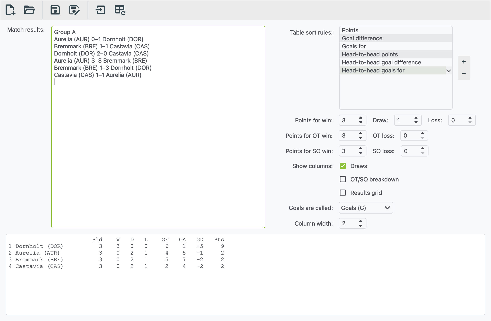

# Table generator

The table generator turns a list of match results into a league table. It
works with results from xkoranate and with results you type or paste in
yourself.

To open it, click the **table** button on the main toolbar, choose
**File › Table generator**, or press <kbd>Ctrl</kbd> <kbd>T</kbd>
(<kbd>⌘</kbd> <kbd>T</kbd> on a Mac). It opens in its own window.



## Making a table

1. **Add your results** to the **Match results** box. Either:
    - click **Import match results…** (the arrow-into-box button) and
      pick a results file. Each file you import is added to the end of
      the box, so you can import Matchday 1, then Matchday 2, and so on;
      or
    - type or paste results into the box, one match per line.
2. **Check the settings** on the right. The defaults suit football.
3. Click **Generate table** (the table button with the circular arrow).
   You can also press <kbd>F5</kbd>, or <kbd>⌘</kbd> <kbd>R</kbd> on a
   Mac.

The table appears at the bottom, ready to copy and paste.

!!! tip "Editing results"
    If you change the text in the Match results box, click
    **Generate table** again to update the table.

## How results need to look

One match per line: home team, score, away team.

```text
Aurelia 3–1 Bremmark
Castavia 2-2 Dornholt
Elsmere 1:0 Farrowland
```

- The score can be written with a dash (`–` or `-`) or a colon (`:`).
- **Extra time and shoot-outs** are understood too:

    ```text
    Aurelia 2–1 OT Bremmark
    Castavia 1–1 Dornholt (1–1 AET) (4–3 pen.)
    ```

    Words such as OT, AET, extra time, golden goal, SO, pen. and shootout
    are all recognised.

- **Other lines are ignored.** Headings such as "Group A", blank lines and
  tables copied from elsewhere can stay in the box.
- **It makes one table.** For a group stage, generate each group
  separately: paste in only that group's matches.
- **Team names must match exactly.** "Aurelia" and "Aurelia (AUR)" count
  as two different teams. Results exported from xkoranate include the
  team code when **Show team names** is on, which is fine as long as every
  matchday is the same.

## Settings

| Setting | What it does |
|---|---|
| **Table sort rules** | What decides places, in order. Usually points, then goal difference, then goals scored. Drag to reorder. **+** adds a rule (such as head-to-head, away goals or coin flip) and **−** removes one. |
| **Points for win / draw / loss** | Points awarded for each result. The defaults are 3, 1 and 0. |
| **Points for OT win / OT loss, SO win / SO loss** | Points for wins and losses in overtime (OT) or a shoot-out (SO). These copy the normal win and loss points until you change them. |
| **Show columns: Draws** | Adds a D column. Untick it for sports without draws. |
| **Show columns: OT/SO breakdown** | Splits wins and losses into regular time, overtime and shoot-out columns |
| **Show columns: Results grid** | Adds a grid of every head-to-head result next to the table |
| **Goals are called** | Changes the column labels to Goals (GF/GA), Korfs, Points or Runs, to suit the sport |
| **Column width** | Makes the number columns wider or narrower |

## Saving

**Save file** keeps your results *and* your settings, as a `.xml` file.
Open it again later, import the next matchday's results, and click
**Generate table** to bring the table up to date.

**New file** clears everything and starts again.

Press <kbd>F1</kbd> in the table generator window to open this page.
